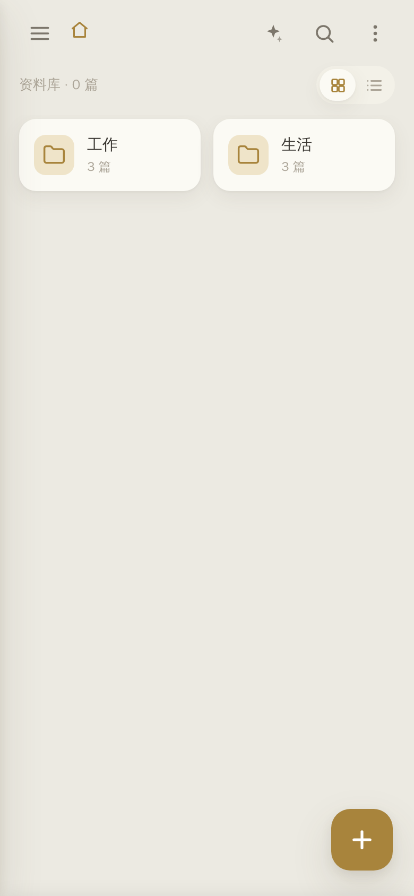
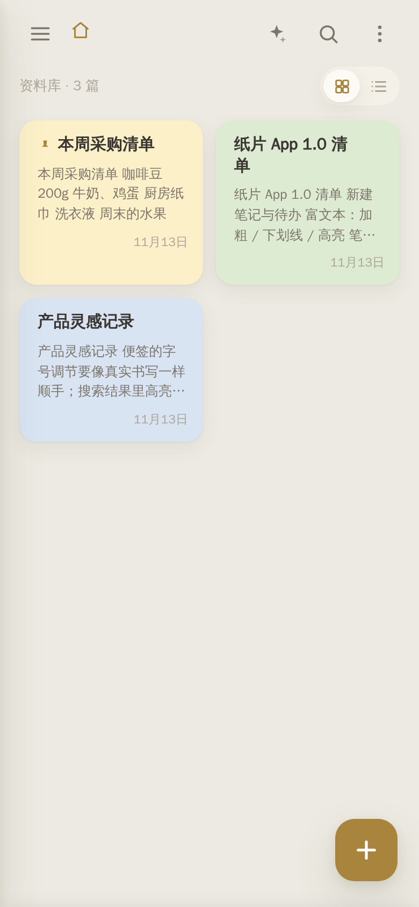
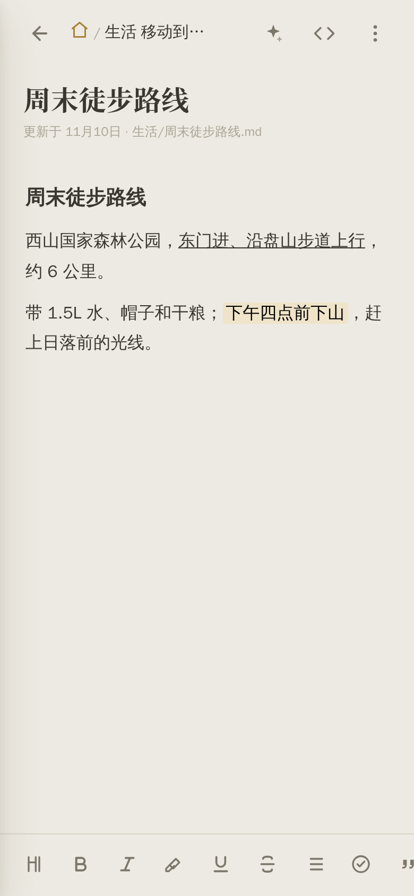
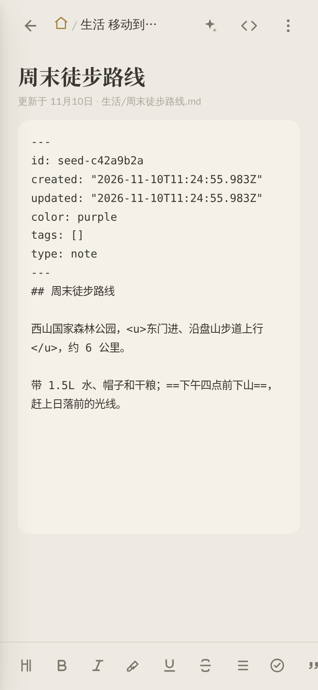
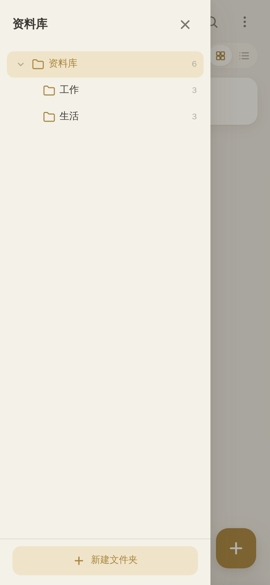
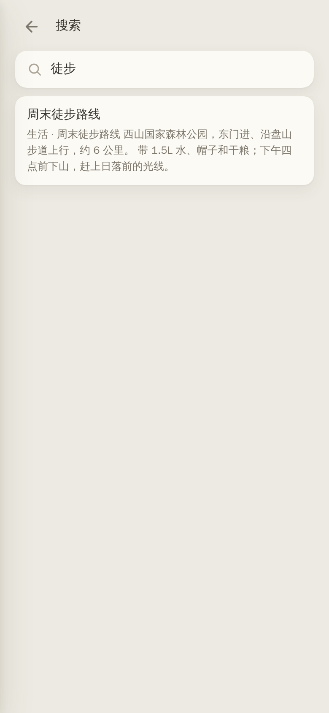
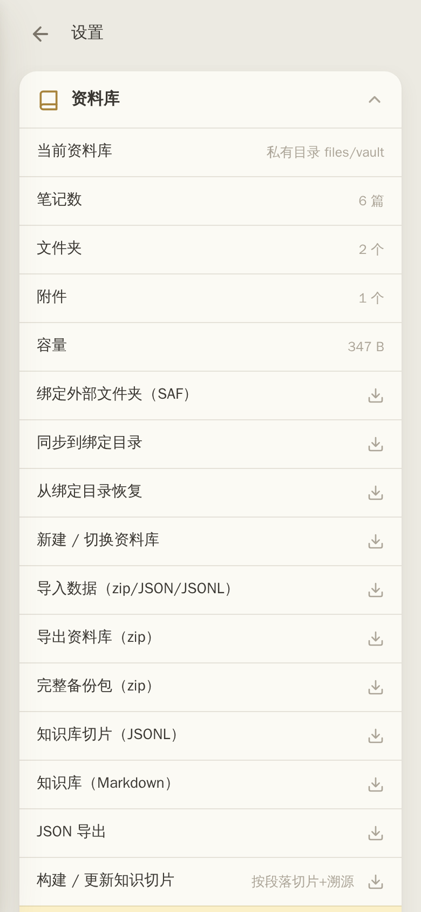
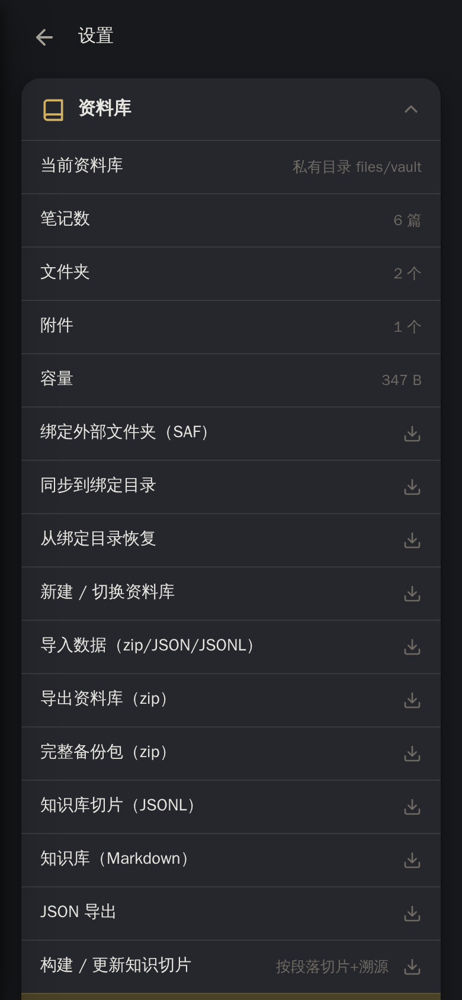
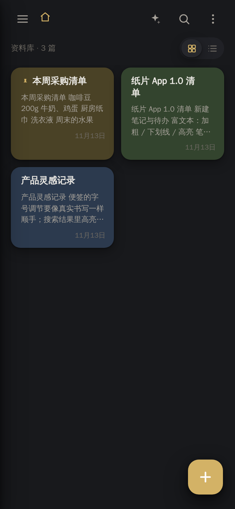

# 纸片 · Zhipian Notes

> 纯本地、离线优先的安卓便签：**Markdown 单文件 + 目录式资料库**，类 Obsidian 的个人知识组织方式，装进一个不依赖任何前端框架的单页 WebView。

一个可直接安装的安卓 App：每篇笔记就是一个带 YAML frontmatter 的 `.md` 文件，文件夹即真实目录，附件落在 `attachments/`，删除进回收站 `.trash/`。内置所见即所得编辑器、待办、双链与高亮、全局搜索、OpenAI 兼容的本页 AI 问答与知识库 RAG、整套导入导出，以及浅 / 深 / 跟随系统三主题与 16 项克制动效。**无账号、无强制联网，数据只存在本机。**

- 当前版本：**v16.0.14**（versionCode 244）
- 包名：`com.zhipian.notes`　·　minSdk 24　·　target / compileSdk 34
- 安装包：约 **3.4 MB** 已签名 Release APK，可直接覆盖安装、保留数据
- 仓库：[github.com/Guzifeng0613/paper-note](https://github.com/Guzifeng0613/paper-note)

---

## 界面速览

| 资料库首页（文件夹） | 文件夹内卡片墙 |
| :---: | :---: |
|  |  |
| **所见即所得编辑器** | **Markdown 源码与 frontmatter** |
|  |  |
| **目录树抽屉** | **全局搜索** |
|  |  |
| **设置（浅色）** | **设置（深色）** |
|  |  |
| **深色模式卡片墙** | |
|  | |

> 以上为生产构建（`dist/index.html`）在手机视口下的真实运行截图，非设计稿；首次启动会写入一份内置示例资料库（工作 / 生活两个文件夹、6 篇笔记），便于直接体验。

---

## 1. 这是什么

「纸片」是一个**单页 WebView 应用**，分两层：

- **网页层**：原生 JavaScript + CSS，不引入任何前端框架 / 打包运行时。源码按模块拆在 `src/js`、`src/css`，由 `scripts/build.js` 按固定顺序拼接进一个 IIFE，产物仍是单个 `index.html`（约 1.1 万行 JS、1.7 千行 CSS）。
- **原生层**：一个全屏 `WebView`，Java 通过 `@JavascriptInterface`（`AndroidBridge`）与 `shouldInterceptRequest` 向网页暴露私有目录读写、选文件 / 拍照、截图导出、SAF 目录、前台服务等能力。

存储默认走浏览器端 OPFS / IndexedDB；在 App 内由原生层落盘到应用私有目录，附件以独立文件存放并建立位置索引。三种后端对上层接口完全一致，同一份业务代码可在浏览器与真机运行。

### 能力一览

- **Markdown 单文件**：标题、加粗 / 斜体 / 删除线、`==高亮==`、`<u>` 下划线、行内码与代码块、引用、列表、待办、分割线、`[[双链]]`、`#标签`、图片与附件。
- **目录式资料库**：嵌套文件夹、面包屑、手风琴目录树、置顶、七色卡片、网格 / 列表切换、回收站还原。
- **所见即所得编辑器**：富文本工具栏、待办勾选与优先级、附件（图片 / PDF / Word / Excel）、一键切换 Markdown 源码，编辑写操作走**串行队列**杜绝竞态丢字。
- **AI 与知识库**：多套 OpenAI 兼容配置、SSE 流式本页问答、按段落切片 + 溯源的知识库与 RAG 混合检索（可选 embedding，失败静默降级）。
- **导入导出**：zip / JSON / JSONL / Markdown 多格式，长截图 PNG 与 PDF 导出；v15 旧库一键迁移（先备份、后转换、再校验）。
- **体验**：浅色 / 深色 / 跟随系统三主题、全局字号刻度尺、haptic 触感、删除二次确认、16 项纸感动效并尊重无障碍降级。

---

## 2. 直接安装

把 Release APK 拷到安卓手机，允许「安装未知来源应用」后点击安装即可。覆盖安装沿用同一签名，会保留原资料库；从 v15 升级时首次进入会提示迁移，旧库自动保留一段时间。

---

## 3. 从源码构建

环境要求：**JDK 17**、**Android SDK**（platform / build-tools 34）、**Node.js**、Gradle 8.9。

```bash
# 1) 拼接网页产物：src/ -> dist/index.html，并同步覆盖根 index.html
node scripts/build.js

# 2) 复制进安卓 assets
cp dist/index.html android/app/src/main/assets/web/index.html

# 3) 构建 Release（必须在 android/ 子目录执行）
cd android
JAVA_HOME=/path/to/jdk-17 ANDROID_HOME=/path/to/android-sdk \
  gradle assembleRelease --no-daemon
# 产物：app/build/outputs/apk/release/app-release.apk
```

对齐与签名（示例用 debug keystore；正式发布请换成自己的密钥库）：

```bash
BT=$ANDROID_HOME/build-tools/34.0.0
$BT/zipalign -p -f 4 app-release.apk app-aligned.apk
$BT/apksigner sign --ks my.keystore --ks-pass pass:*** --key-pass pass:*** \
  --ks-key-alias mykey app-aligned.apk
$BT/apksigner verify --print-certs app-aligned.apk
```

> `file://` 下 OPFS 不可用，本地预览请起静态服务，例如在仓库根目录执行 `python3 -m http.server 8765` 后访问 `http://localhost:8765/`。

---

## 4. 架构：三层各司其职

| 层 | 模块（全局名） | 职责 |
| --- | --- | --- |
| 文件系统 | `vault-fs.js`（`VaultFS`） | 仅做文件 / 目录操作，三后端 `native` / `opfs` / `idb`；原子写（`.tmp`+`rename`）、附件、SAF、zip |
| 业务索引 | `vault.js`（`Vault`） | 只索引 `.md`，全量扫描建索引 + 后台增量；搜索、树、面包屑、写盘调度、统计 |
| Markdown 引擎 | `markdown.js`（`MD`） | frontmatter 解析 / 序列化、块级 AST、MD↔HTML 可逆、待办行回写、摘要与标签抽取 |
| 迁移 | `migrate.js`（`Migrate`） | 旧库检测、先备份、HTML→MD、附件搬迁、`verify()` 校验解析率 |
| 双向同步 | `vault-sync.js`（`VaultSync`） | 新资料库与旧 v15 数据模型互相同步，供旧屏（AI / 设置 / 云）复用 |
| 界面 | `vault-ui.js` 等 | v16 卡片墙、编辑器、抽屉、设置、弹层、写操作串行队列 |

**单文件物理结构：**

```
vault/
├── 工作/
│   ├── 周会纪要.md            # 笔记 = frontmatter + Markdown 正文
│   └── attachments/周会纪要/   # 该笔记的附件
├── 生活/
├── attachments/               # 全局附件目录
└── .trash/                    # 回收站（保留相对结构，可还原）
```

frontmatter 字段：`id`、`created`、`updated`、`tags`、`type`（note / todo）、`color`、`pinned`。文件名为 `${标题}.md`，空标题落 `未命名.md`，同目录重名自动加序号（`标题 2.md`）。接口契约详见 [docs/VAULT-INTERFACE.md](docs/VAULT-INTERFACE.md)。

---

## 5. Markdown 方言（Obsidian 兼容子集）

| 写法 | 渲染 | 写法 | 渲染 |
| --- | --- | --- | --- |
| `## `～`###### ` | 标题 | `**粗**` / `*斜*` | 加粗 / 斜体 |
| `==文字==` | 高亮 | `<u></u>` | 下划线 |
| `~~文字~~` | 删除线 | `` `code` `` / ` ``` ` | 行内码 / 代码块 |
| `- ` / `1. ` | 无序 / 有序列表 | `> ` | 引用 |
| `- [ ]` / `- [x]` | 待办 | `#p/high` `#p/low` | 待办优先级 |
| `` / `![[path]]` | 图片 | `[名](path)` | 其他附件 |
| `[[名]]` | 双链 | `#标签` | 标签 |

富文本工具栏产出的全部元素都可在 HTML 与 Markdown 间双向无损转换；`samples/vault-syntax/` 提供了 10 个语法样例与一份 Obsidian 兼容核对清单。

---

## 6. AI 与知识库

- **多配置管理**：保存多套 OpenAI 兼容服务（`baseUrl` / `key` / `model` / 可选 `embModel`），本地存储、可切换、可测连通。
- **本页问答**：编辑器内基于当前笔记上下文问答，走 `chat/completions` **SSE 流式**输出；未配置时给出引导提示，接口报错（如 401）显示可读错误，不崩溃。
- **知识库 RAG**：按段落把资料库切片并保留溯源，检索时 BM25 与哈希语义向量混合召回；配置了兼容 embedding 接口才启用向量路，模型不可用自动回退本地规则，不阻塞阅读。
- **隐私边界**：仅在你主动触发时，才把当前页内容发往**你自己配置**的模型服务；App 本身不内置任何第三方 Key。

---

## 7. 数据、迁移与备份

- **导入**：统一入口识别 zip / JSON / JSONL，支持「合并 / 覆盖」，导入后自动回写为 vault 中的 `.md` 文件。
- **导出**：资料库 zip、完整备份包、知识库 JSONL / Markdown、JSON，以及单篇长截图 PNG 与 PDF；原生端写入系统导出目录并返回路径。
- **旧库迁移（v15 → v16）**：笔记本 → 文件夹、HTML 正文 → Markdown、待办 → checkbox + 优先级、附件 → `attachments/` 并重写引用、frontmatter 沿用旧 uid / 时间戳 / 颜色 / 置顶 / 标签。流程为先导出完整备份 zip，再转换，最后 `verify()` 校验（解析率需 100%），旧库保留并到期自动清理。
- **外部目录（SAF）**：可绑定系统文件夹，把资料库同步到绑定目录或从其恢复，便于与其他工具互通。

---

## 8. 测试

自动化基于 Playwright（headless Chromium），通过 HTTP 服务运行，覆盖 CRUD、目录、待办、颜色 / 移动 / 置顶、回收站、搜索、源码模式、弹层、AI 流式问答（mock SSE）、知识库切片检索、文件导入等链路。当前共 **12 套、103 条断言全绿**：

```bash
export PLAYWRIGHT_BROWSERS_PATH=/path/to/ms-playwright
node _verify/v16_smoke_final.js   # 冒烟 24 项
node _verify/t_ai_flow.js         # AI 流式问答
node _verify/t_kb_rag.js          # 知识库切片 + RAG
node _verify/t_import.js          # JSON 导入与 vault 回写
# 其余：t_deep_func / t_deep2 / t_audit_all / t_edge / t_edge2 / t_trash / t_newfeat / t_modal
```

---

## 9. 目录结构

```
paper-note/
├── src/
│   ├── index.html              # 骨架（含 /*__CSS__*/ /*__JS__*/ 占位）
│   ├── js/                     # 经典脚本模块（见第 4 节）
│   └── css/                    # 设计 token、主题与各屏样式
├── scripts/build.js            # 单文件拼接构建
├── android/                    # 安卓工程
│   ├── app/build.gradle        # versionCode / versionName
│   └── src/main/
│       ├── AndroidManifest.xml
│       ├── java/com/zhipian/notes/   # MainActivity / ZhipianWebView / Bridge / Storage …
│       └── assets/web/index.html     # 打包用副本
├── vendor/                     # 本地附件解析：pdf.js / mammoth / xlsx / jszip
├── samples/vault-syntax/       # Markdown 方言样例
├── docs/                       # 接口契约、接线说明、界面截图
├── dist/index.html             # 构建产物
└── _verify/                    # Playwright 回归套件
```

---

## 10. 隐私与权限

纸片不设账号、不采集任何个人数据，笔记 / 图片 / 附件 / AI 配置仅保存在本设备。应用只申请最小权限：

| 权限 | 用途 |
| --- | --- |
| `INTERNET` | 仅在你主动使用 AI 时访问你配置的模型接口 |
| `VIBRATE` | 操作触感反馈（haptic） |
| `FOREGROUND_SERVICE` / `FOREGROUND_SERVICE_DATA_SYNC` | 备份 / 同步前台服务 |
| `POST_NOTIFICATIONS` | 前台任务进度通知 |

拍照、选文件、访问目录等通过系统选择器 / FileProvider 按需授权，不在后台读取无关文件。

---

## 11. 已知边界与路线

- 拍照、附件原生打开 / 分享、SAF 目录推送等依赖真机系统能力，浏览器自动化无法完整覆盖，需在设备上验收。
- AI 的真实联网效果取决于你所配置服务的网络与质量；浏览器回归使用 mock SSE，验证的是链路与渲染而非具体回答内容。
- 百度网盘同步在 v16 设置中保留入口、暂标记「即将上线」，当前以本地 SAF 与文件导入导出替代跨端备份。
- 仅面向安卓端维护；网页层可在现代浏览器中运行，但三后端里的 `native` 能力只在 App 内可用。

---

相关文档：[docs/VAULT-INTERFACE.md](docs/VAULT-INTERFACE.md)（三层接口契约）、[docs/V16-WIRING-PATTERN.md](docs/V16-WIRING-PATTERN.md)（新旧屏接线模式）、[ACCEPTANCE.md](ACCEPTANCE.md)（版本验收记录）。
